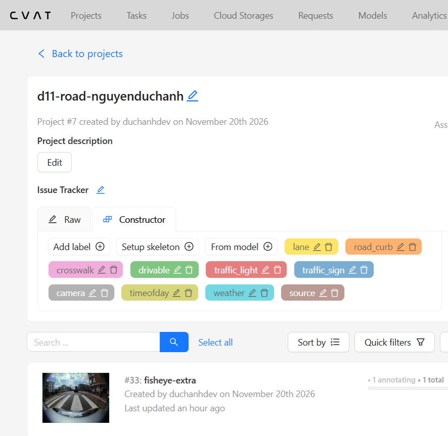
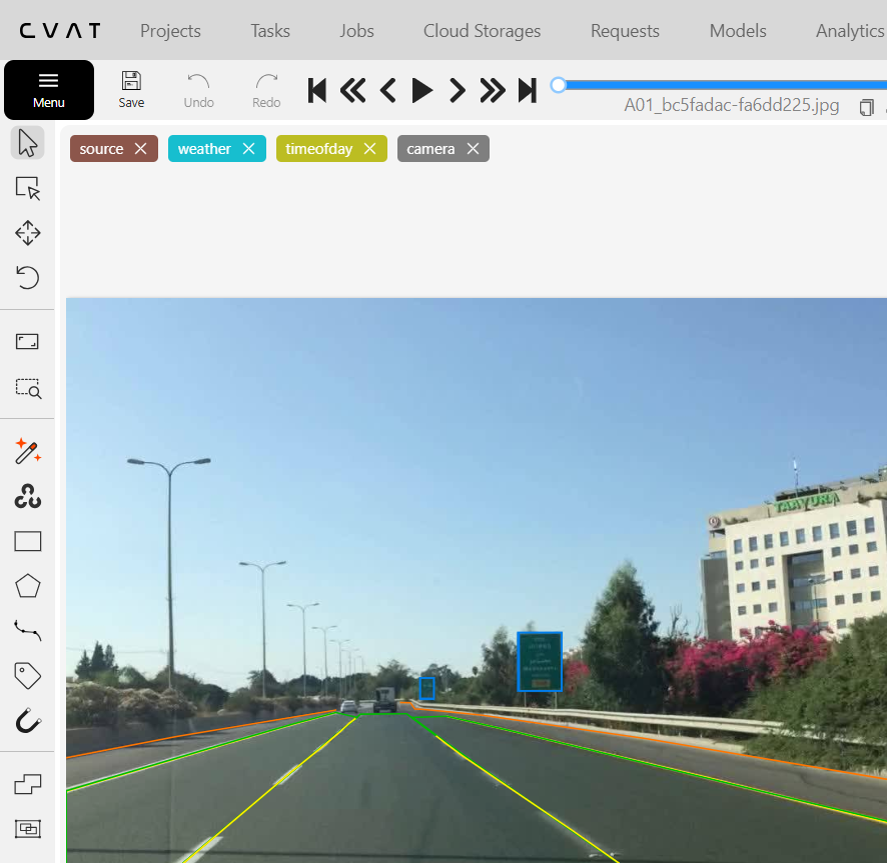
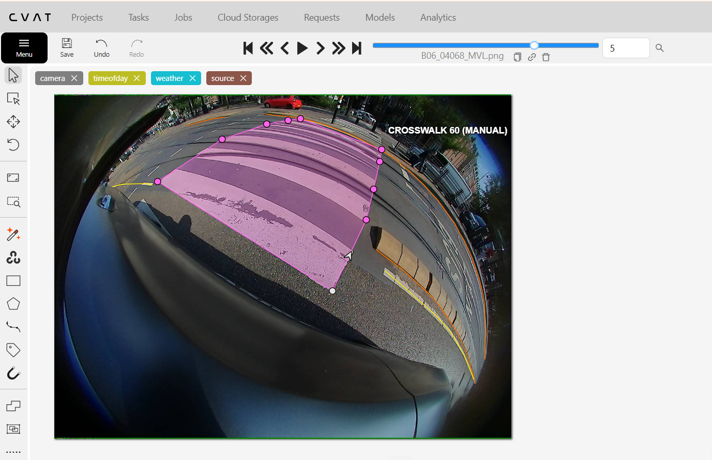
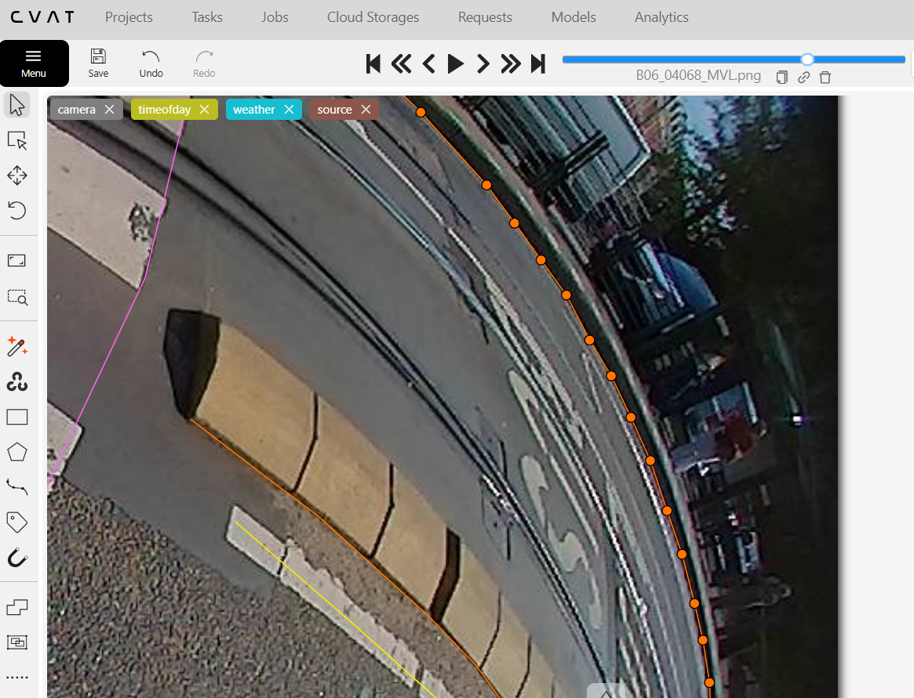

# Báo cáo cá nhân — Ngày 11
Họ tên: Nguyễn Đức Hạnh               Mã học viên: 2A202603344
Phiên bản CVAT (Help → About): 2.81.0
Guideline: Road v1.0    Lần nộp (`revision` trong manifest): 1
Thời điểm export (ngày giờ trên CVAT): front 21/11/2026 11:05, fisheye 21/11/2026 01:13    Số lần nộp lại sau Rework: 0

## 1. Kiểm project
Project `d11-road-nguyenduchanh` trên CVAT localhost.

| Mục | Đúng như guideline Road v1.0? | Ghi chú |
| --- | --- | --- |
| 6 label, đúng kiểu | có | lane, road_curb = polyline; crosswalk, drivable = polygon; traffic_light, traffic_sign = rectangle |
| Thuộc tính và giá trị | có | lane: position L1 R1 L2 R2 other, style solid dashed, color white yellow other, kind single double. drivable: area_type direct alternative. Đèn: color, type, facing, edge_zone. Biển: group, facing, edge_zone |
| 4 tag ảnh | có | camera, timeofday, weather, source. Mỗi tag một thuộc tính select tên `value` |
Cách kết thúc polyline trên bản CVAT này: click các điểm từ gần xe ra xa, bấm phím N để kết thúc polyline.
Cách đặt tag ảnh trên bản CVAT này: công cụ Tag, đặt camera trước rồi timeofday, weather, source. Mỗi tag là một label kiểu Tag, giá trị nằm ở thuộc tính `value`. Mở Details vì CVAT tự điền giá trị đầu danh sách.

## 2. Số lượng đã gán
| Task | Ảnh | lane | road_curb | crosswalk | drivable | traffic_light | traffic_sign |
| --- | ---: | ---: | ---: | ---: | ---: | ---: | ---: |
| front | 12 | 34 | 20 | 11 | 25 | 40 | 17 |
| front-extra (đã làm 4 / 4) | 4 | 13 | 6 | 6 | 7 | 10 | 10 |
| fisheye | 8 | 7 | 10 | 7 | 4 | 5 | 5 |
| fisheye-extra (đã làm 4 / 4) | 4 | 0 | 4 | 4 | 2 | 0 | 0 |

## 3. Bảng ca khó
| Ảnh | Nhãn | Phân vân giữa | Đã chọn | Lý do |
| --- | --- | --- | --- | --- |
| A04, A11, A14 | lane | Một polyline `kind=double` hay hai polyline | Hai polyline cùng `position=L1` | Lab Coach yêu cầu vẽ vạch đôi thành hai đường. Lint vẫn báo QC1-05 vì checker coi hai polyline cùng position là vạch đứt bị tách. Giữ theo lời coach. |
| A05 | lane | Vẽ L1/R1 hay bỏ | Không vẽ L1, không vẽ R1. Có `road_curb` | Phóng ảnh không thấy vạch sơn dọc, hai bên là xe đỗ. QC1-02 trên lint là ca miễn khi coach xác nhận không có vạch. |
| A09 | lane | Vẽ R1 hay bỏ | Có L1, không vẽ R1. Có `road_curb` | Bên phải không thấy vạch sơn tương ứng, chỉ thấy mép lề. QC1-02 "chưa có R1" được giữ và ghi phiếu. |
| A07 | lane | Vẽ L1 hay bỏ | Có R1 và R2, không vẽ L1. Có `road_curb` | Bên trái là dải phân cách, không thấy vạch sơn L1. Vạch mép phải là R2, vạch sát xe là R1. QC1-02 "chưa có L1" được giữ. |

## 4. Phiếu QC 1 nhận được
Bạn kiểm lô của tôi: Nguyễn Tiến Thịnh (NguyenTienThinh), phiếu `NguyenTienThinh-qc1-for-nguyenduchanh.md`    Quyết định nhận được: Hold
Phiếu đếm đúng file đang nộp: A01 11 shape, A03 15, A04 8, A07 8, A08 31, B06 6 shape, mỗi ảnh 4 tag. `revision` trong manifest là 1.

| Mã lỗi | Số lỗi | Đồng ý? | Đã sửa? |
| --- | ---: | --- | --- |
| QC1-05 A04 hai polyline L1 | 1 | không | chưa. Hai nét vẫn ở (19,556) và (62,554). Giữ theo lời Lab Coach, mục 3 |
| QC1-06 A03 L1 vàng ghi single | 1 |  | chưa. Lane bắt đầu (204,720) vẫn `kind=single` |
| QC1-07 A01 direct thứ hai | 1 |  | chưa. Polygon direct `(422,511)–(1280,720)` vẫn là `direct` |
| QC1-07 B06 thiếu drivable | 1 |  | chưa. B06 có 6 shape, không có polygon drivable |
| QC1-01 weather A04, A08 overcast và A07 rain | 3 |  | chưa. Cả ba ảnh vẫn `weather=clear` |
| QC1-12 B06 điểm curb trùng | 1 |  | chưa. Điểm lặp vẫn ở road_curb `(1206,744)` |

Năm ca chờ lead chưa có lời đáp, nên phiếu là Hold. Hai ca A07 (miễn L1 hay không; vạch ngoài cùng là R2 hay `other`) nếu bị tính thành lỗi nặng thì phiếu chuyển Rework. Ba ca kia là occluded và `timeofday` của A03, và crosswalk cùng road_curb thêm ở B06.

## 5. Kiểm file export
Số shape trong file zip. Tag camera có trong XML. Manifest `nguyenduchanh-manifest.json` revision 1, `contains_images` là false.

| File | Mở lại được? | Số shape ảnh 1 trong file | Số shape ảnh 2 trong file | Tag camera có trong XML? |
| --- | --- | --- | --- | --- |
| nguyenduchanh-front.zip | có (`road_check lint`) | A01: 11 | A02: 8 | có, `front` |
| nguyenduchanh-fisheye.zip | có (`road_check lint`) | B01: 3 | B02: 6 | có, `fisheye_front` |

## 6. Ảnh chụp màn hình
Chụp trên CVAT 2.81.0, project `d11-road-nguyenduchanh`, user duchanhdev.

1. Tab Constructor (labels) của project.



2. Ảnh camera trước A01, job front: tag, lane, drivable, traffic_sign.



3. Ảnh fisheye B06 (`B06_04068_MVL.png`): polyline lane và road_curb bám theo cung. Ảnh thứ hai là phần phóng to đoạn cong.





4. Một đoạn XML có polyline lane, trích `nguyenduchanh-front.zip`, ảnh A01:

```xml
<polyline label="lane" source="manual" occluded="0" points="1280.00,704.97;1056.78,653.57;929.33,622.37;778.28,584.55;619.80,546.90;531.90,525.80;464.30,510.60" z_order="0">
  <attribute name="position">R2</attribute>
  <attribute name="style">solid</attribute>
  <attribute name="color">yellow</attribute>
  <attribute name="kind">single</attribute>
</polyline>
```

## 7. Tự đánh giá
Lỗi mắc nhiều nhất là QC1-03: lane ở camera hai bên (B06, B07, B08) để `position` là L1 hoặc R1. Cách tránh ở Ngày 20: đọc camera từ tên file trước khi sửa thuộc tính. MVL và MVR luôn là `other`. Fisheye đếm số điểm trên cung trước khi Save, vì curb 2–3 điểm bị QC1-11.

Nhãn đi vào model ở bước học làn theo hàng (row-anchor). Lỗi đã sửa là các vạch B06–B08 gán L1/R1. Model sẽ học đường cong của camera hông thành làn xe đang đi, nên đích LKA bị lệch sang hai bên. Đổi `position` thành `other` thì những vạch đó không còn là đích L1/R1 của làn ego.

## 8. (Tùy chọn, buffer) Từ polyline đến đích row-anchor
Ảnh A01, lane `position=R1`. Hàng của Nguyễn Tiến Thịnh lấy từ `NguyenTienThinh-front.zip`. Hai polyline cùng vạch đứt bên phải làn xe.

| y | 720 | 680 | 640 | 600 | 560 |
| --- | ---: | ---: | ---: | ---: | ---: |
| x của chúng tôi | 716.9 | 660.1 | 602.8 | 543.9 | 484.9 |
| x của bạn kia | 706.1 | 657.0 | 605.8 | 544.8 | 486.6 |

Trả lời 3 câu:

1. Polyline R1 của A01 kết thúc ở y = 534.6. Dừng sớm 40 px thì điểm xa còn khoảng y = 575. Hàng 560 nằm ngoài polyline và thành "không có làn". Bốn hàng 720, 680, 640, 600 vẫn còn x.
2. Hàng 720: 716.9 và 706.1, lệch 10.8 px. Hàng 560: 484.9 và 486.6, lệch 1.7 px. Lệch ở hàng 720 ảnh hưởng LKA nhiều hơn vì đó là điểm gần xe. Hàng 560 đã ở xa, cùng một số pixel lệch làm góc lái đổi ít hơn.
3. Năm số x không đổi khi đảo chiều polyline, vì `x_at_y` nội suy theo y của từng đoạn, không theo thứ tự điểm. Script gặp khó là `road_check`: điểm đầu phải là đầu gần xe. Vẽ từ xa về gần bị QC1-04 và đo nhầm hai đầu so với GT.
